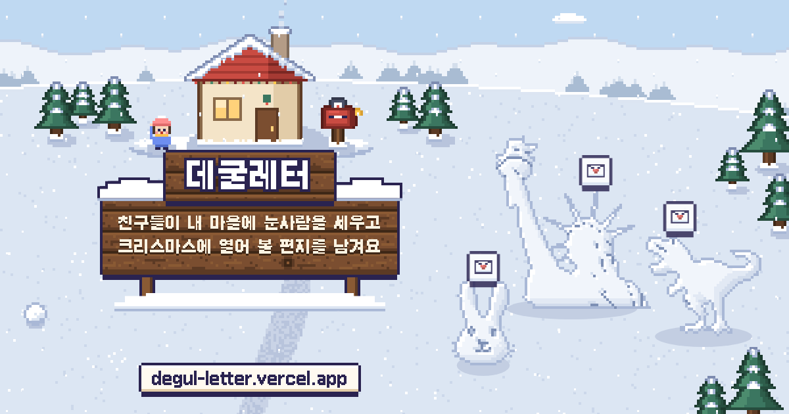
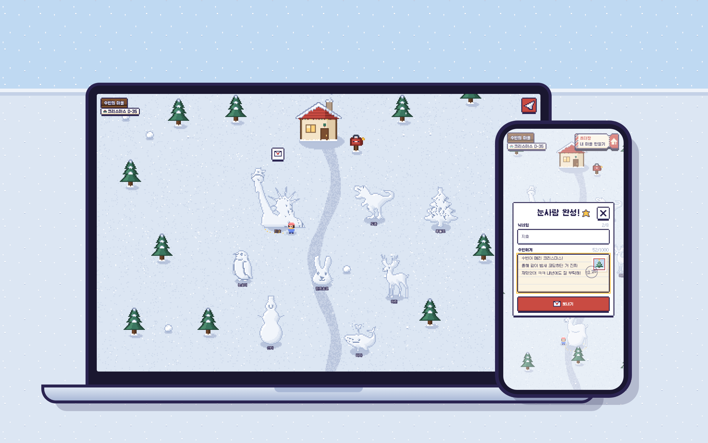
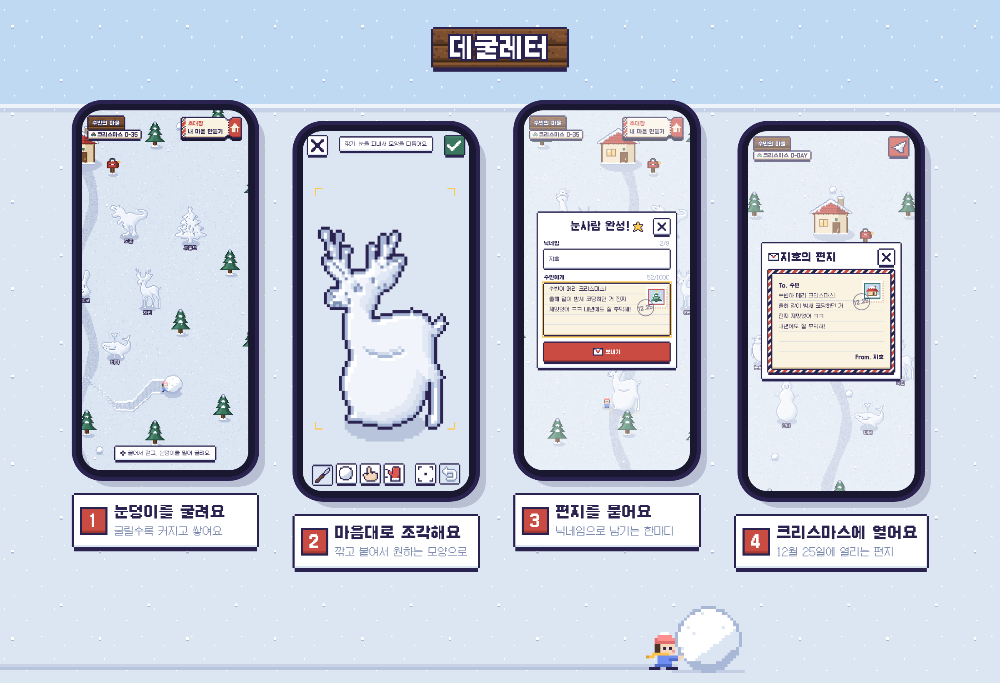

# 데굴레터



크리스마스에 열어 볼 편지를, 눈사람을 세우는 놀이로 남기려고 만들었습니다. 방문자는 계정을 만들지 않고 공유 링크로 바로 들어오고, 마을을 지키는 사람만 로그인합니다.

🔗 **https://degul-letter.vercel.app**



## 주요 기능

| 기능               | 설명                                                                                      |
| ------------------ | ----------------------------------------------------------------------------------------- |
| 눈덩이 굴리기·쌓기 | 마을을 걸어 다니며 눈덩이를 밀어 굴리고, 최대 4단까지 쌓습니다.                           |
| 눈조각             | 칸마다 비었음·눈·움푹·이음새 중 하나로 깎고, 붙이고, 누르고, 문지릅니다.                  |
| 편지               | 눈사람 하나에는 편지 한 통. 한국 시간 12월 25일 0시 전에는 브라우저에서 읽을 수 없습니다. |
| 마을 공유          | 마을마다 짧은 코드(`/v/코드`)가 있습니다. 링크만 보내면 친구가 들어옵니다.                |
| 로그인             | 마을을 만들 때만 카카오 또는 구글로 로그인합니다. 익명으로 쓰던 계정이 그대로 이어집니다. |
| 로그아웃           | 공용 컴퓨터에서 다음 사람이 내 마을에 들어오지 못하게 세션을 끊습니다.                    |



그림 속 편지 문장은 화면을 보여 주려고 적은 예시이고, 저장하지 않았습니다.

## 기술 스택

| 분야       | 사용 기술                                                | 선택 이유                                                                |
| ---------- | -------------------------------------------------------- | ------------------------------------------------------------------------ |
| 프레임워크 | Next.js 16 (App Router, Turbopack), React 19, TypeScript | 화면은 앱 라우트, 편지 열기처럼 서버 키가 필요한 일은 `app/api`에서 처리 |
| 스타일     | Tailwind CSS 4, 갈무리체                                 | 글자·간격·칸을 3px(`--p`) 그리드와 팔레트 CSS 변수로 맞춤                |
| 게임       | Canvas API                                               | 게임 엔진 라이브러리 없이, 도트 1칸을 직접 그림                          |
| 백엔드     | Appwrite (Database, Auth) + Next.js 서버                 | 계정·테이블은 Appwrite. 편지 열기·로그인·마을 만들기처럼 서버 키가 필요한 일은 Next.js 서버(`app/api`)가 함. 편지 표에는 읽기 권한을 두지 않음 |
| 로그인     | 카카오·구글 OAuth 2.0 인가 코드                          | Appwrite 기본 로그인이 아니라, 서버가 회원번호·`sub`만 받아 계정을 잇음  |
| 패키지     | pnpm                                                     |                                                                          |
| 배포       | Vercel                                                   | 주소는 `https://degul-letter.vercel.app`                                 |

### 폴더 구조

도메인마다 `components/`, `hooks/`, `lib/`, `api.ts`, `types.ts`로 나눕니다. 다른 도메인은 그 도메인의 `index.ts`로만 가져옵니다.

```
src/
├── app/          # 라우트와 API (/, /v/[code], /privacy, /terms, /api)
├── domains/
│   ├── village/  # 마을 캔버스, 마을 만들기, 공유 링크
│   ├── snowman/  # 눈조각, 저장
│   ├── letter/   # 편지, 12월 25일 잠금, 열기
│   └── auth/     # 카카오·구글 로그인
└── shared/       # Appwrite 클라이언트, 환경 변수, 픽셀 UI
```

## 고민한 것들

**3px 그리드와 캔버스**
버튼·여백·도트 한 칸을 `--p`(3px)로 맞춥니다. 마을 캔버스의 기본 배율도 3입니다. 캔버스는 매 프레임 CSS 변수를 읽지 않아서, 같은 색을 `globals.css`와 `render.ts`의 `PAL`에 각각 적습니다. 색을 바꾸면 두 곳을 같이 바꿉니다.

**눈조각은 칸의 값**
눈사람 모양은 그림 파일이 아니라 칸의 배열입니다. 칸은 비었음, 눈, 눌러 들어간 움푹, 눈덩이 사이 이음새 중 하나입니다. 깎기·붙이기·누르기·문지르기가 그 값을 바꿉니다.

**편지는 12월 25일 전에는 읽을 수 없게**
편지 테이블에는 읽기 권한을 주지 않습니다. 마을 주인도 브라우저에서는 읽지 못합니다. 한국 시간 12월 25일 0시 이후, 그 마을 주인일 때만 Next.js 서버가 서버 키로 읽어 내려줍니다. 눈사람은 `letterId`로 편지를 가리킬 뿐, 내용은 들고 있지 않습니다.

**구경은 로그인 없이, 마을 만들기는 로그인 뒤에**
처음 온 브라우저는 Appwrite 익명 계정으로 바로 눈사람을 세울 수 있습니다. 마을을 만드는 사람만 카카오 또는 구글로 로그인합니다. 로그인하면 그 익명 계정을 `identities`에서 `kakao_회원번호` 또는 `google_sub`에 잇기 때문에, 로그인 전에 만든 마을이 따라옵니다.

**마을 만들기는 서버만**
화면에서 마을 만들기를 숨기는 것만으로는, 개발자 도구로 익명 계정도 마을을 만들 수 있었습니다. 마을 테이블의 만들기 권한을 없애고 `/api/villages`가 확인한 뒤에만 서버 키로 만듭니다. 확인은 서버만 붙일 수 있는 `kakao`·`google` 라벨입니다. 계정 설정값(`prefs`)은 브라우저에서 고칠 수 있어서 보지 않습니다. 익명 계정이 prefs만 바꿔도 403입니다. 한 계정에 마을은 하나입니다.

**마을을 나갔다 다시 들어오면 화면이 비던 문제**
Next.js가 떠난 페이지를 언마운트하지 않고 React Activity로 숨깁니다. 숨기는 동안 캔버스 크기가 0이 되고, 엔진은 사라지는데 화면 상태는 남아서 집·나무가 없고 망치만 남은 적이 있습니다. 다시 들어올 때 상태를 비우고 마을을 다시 불러오고, 가로·세로가 0인 리사이즈는 무시합니다.

**공용 컴퓨터**
카카오 로그인만 브라우저에 남아 있으면 다음 사람이 내 마을에 들어올 수 있습니다. 로그아웃은 Appwrite 세션을 지우고, 카카오 계정이면 카카오 로그아웃 페이지까지 거칩니다. 구글은 다른 구글 서비스까지 나가지 않게 앱 세션만 끊습니다. 구글 로그인 화면은 매번 계정을 고르게 합니다.

**구글은 회원번호만, 앱 안 브라우저는 따로**
구글에는 `openid`만 요청하고, 변하지 않는 `sub`만 저장합니다. 이메일·이름은 받지 않습니다. 구글은 카카오톡·인스타그램 같은 웹뷰에서 로그인을 막으므로, 카카오톡은 바깥 브라우저로 열고, 다른 안드로이드 인앱은 `intent://`를 쓰고, iOS에서 그럴 수 없으면 구글 단추를 눌렀을 때 링크를 복사하고 "Safari에서 열어 주세요" 알림을 띄웁니다. 단추 배치는 어디서든 같습니다. 카카오 로그인은 카카오톡 안에서도 됩니다.

## 개발 방식

기능과 화면 기준은 [AGENTS.md](AGENTS.md)에 적어 두고 그에 맞춰 작업했습니다. 화면은 브라우저에서 눌러 보며 확인했습니다.

## 실행

```bash
pnpm install
cp .env.example .env.local
pnpm dev
```

`.env.local`은 커밋하지 않습니다. 값의 이름만 적으면 다음과 같습니다.

- `NEXT_PUBLIC_APPWRITE_ENDPOINT`, `NEXT_PUBLIC_APPWRITE_PROJECT_ID`, `NEXT_PUBLIC_APPWRITE_DATABASE_ID`
- `APPWRITE_API_KEY` (서버 전용)
- `KAKAO_REST_API_KEY`, `KAKAO_CLIENT_SECRET`
- `GOOGLE_CLIENT_ID`, `GOOGLE_CLIENT_SECRET` (서버 전용, `NEXT_PUBLIC_` 없음)
- `AUTH_SECRET` (카카오·구글 상태 쿠키 서명)

테이블은 `pnpm setup:appwrite`로 맞춥니다.
